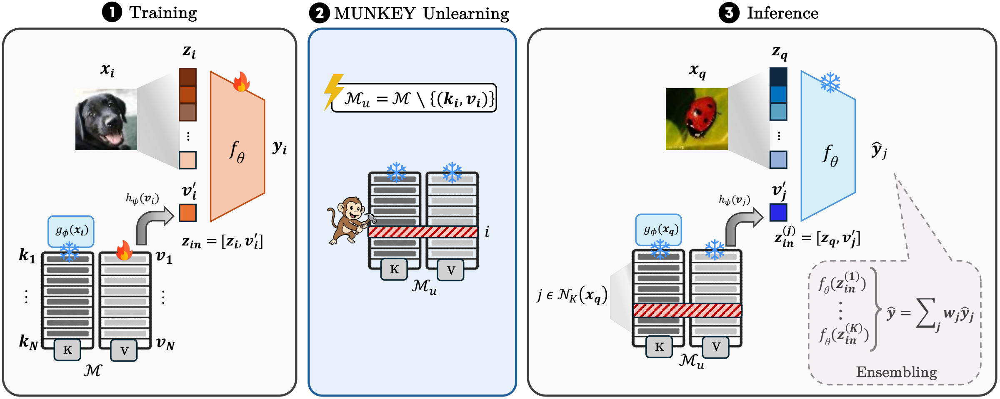

# MUNKEY: Machine Unlearning via Key Deletion

This repository contains the implementation of [**Models Designed to Forget: Machine Unlearning via Key Deletion**](https://arxiv.org/pdf/2603.15033), presented at **the Fortieth Annual Conference on Neural Information Processing Systems (NeurIPS 2026).**

**Abstract:** Machine unlearning for vision models is rapidly becoming a practical requirement, driven by privacy regulations, data errors, and the need to remove harmful or corrupted training images. Despite this, most existing approximate unlearning methods tackle the problem from a post-hoc perspective. They attempt to erase the influence of targeted samples through parameter updates that typically require access to the full training data. This creates a mismatch with real deployment scenarios where unlearning requests can be anticipated, revealing a fundamental limitation of post-hoc approaches. We motivate *unlearning by design*, a novel paradigm for approximate methods in which models are directly trained to support forgetting as an inherent architectural capability. We instantiate this idea with Machine UNlearning via KEY deletion (MUNKEY), a memory-augmented transformer that decouples instance-specific memorization from model weights. Here, unlearning corresponds to removing the instance-identifying key, enabling zero-shot forgetting without weight updates or access to the original samples or labels. Across natural image benchmarks, fine-grained visual recognition, and medical datasets, MUNKEY outperforms all post-hoc baselines. Our results establish that *unlearning by design* enables fast, deployment-oriented unlearning while preserving predictive performance.

[](media/MUNKEY_main_figure.pdf)

## Install

Use Python 3.9–3.11 and a CUDA GPU for full experiments. CPU execution is supported for small checks.

```bash
python -m venv .venv
source .venv/bin/activate
pip install -r requirements.txt
```

The frozen key encoder (`google/vit-base-patch16-224`) downloads from Hugging Face on the first run. Set `model.models_path=/path/to/model` to use a local copy.

## Data

By default, data lives in `./datasets`. CIFAR-10, CIFAR-100, and the 224-pixel DermaMNIST, PathMNIST, and BloodMNIST datasets download automatically. For TinyImageNet, extract the original archive into `datasets/tiny-imagenet-200/`, including `wnids.txt`, `train/`, and `val/val_annotations.txt`.

Override the location with `dataset.data_path=/path/to/datasets`. Key caches and forgetting indices are stored in `./cache`.

## Run

There are two training modes: `token` (MUNKEY, the default) and `scratchV` (Retrain M). Standard membership-inference metrics are included; RMIA is optional.

Train MUNKEY and evaluate before and after key deletion:

```bash
python main.py --config-name=cifar10
python main.py --config-name=cifar100
python main.py --config-name=dermamnist
python main.py --config-name=pathmnist
python main.py --config-name=bloodmnist
python main.py --config-name=tinyimagenet
```

Train Retrain (M) from scratch on the retained set, using the same memory architecture and settings:

```bash
python main.py --config-name=cifar10 mode=scratchV
```

Replace `cifar10` with any of the six dataset names above. Use the same seed and forget fraction as the corresponding MUNKEY run. Forgotten examples are excluded from both the augmented training loader and retrieval throughout training and evaluation. Runs initialize fresh unless explicitly resumed.

The default settings use the following image/token dropout probabilities, following the manuscript:

| Dataset | Image dropout | Token dropout |
| --- | ---: | ---: |
| CIFAR-10 | 0.1 | 0.3 |
| CIFAR-100 | 0.1 | 0.3 |
| DermaMNIST | 0.3 | 0.1 |
| PathMNIST | 0.1 | 0.1 |
| BloodMNIST | 0.3 | 0.1 |
| TinyImageNet | 0.1 | 0.1 |

Shared settings: 100 epochs, training batch size 96, evaluation batch size 32, AdamW with learning rate `5.625e-5`, weight decay `0.05`, betas `(0.9, 0.99)`, and cosine decay. The learning rate scales with training batch size unless explicitly overridden. Images are resized to 224 pixels; memory tokens have dimension 128. The default forget fraction is 10%; CIFAR-10 uses random sampling and the other datasets use class-proportional sampling. Validation and testing use a softmax-weighted four-neighbour logit ensemble, with temperature 0.07.

Use the three experiment seeds and select other backbones with:

```bash
python main.py --config-name=cifar10 -m seed=42,53,11
python main.py --config-name=cifar10 model=vit-b
```

## Aggregation strategies

These are optional aggregation strategies settings available for MUNKEY (Following Table 3 in the manuscript).

```bash
# Softmax or rank-weighted token mixing at evaluation, instead of ensembling
python main.py --config-name=cifar10 mode.aggregation=softmax mode.eval_use_token_ensemble=false
python main.py --config-name=cifar10 mode.aggregation=rank mode.eval_use_token_ensemble=false

# Direct projected keys, without k-NN token retrieval
python main.py --config-name=cifar10 mode.use_key_as_token=true \
  mode.knn_train_prob=0 mode.eval_use_token_ensemble=false

# Softmax-aggregate neighbor tokens, then apply cross-attention
python main.py --config-name=cifar10 mode.aggregation=softmax_CA mode.eval_use_token_ensemble=false

# Reinsert the token at every ViT layer (deep prompt)
python main.py --config-name=cifar10 mode.deep_prompt=true
```

 `mode.eval_topk` controls evaluation neighbors (4 by default). Direct keys bypass instance memory, so excluding memory keys does not change their predictions.

## Checkpoints and logs

Metrics and the resolved configuration are saved under `outputs/metrics/`. Checkpoints are saved under `outputs/ckpts/`; the exact directory is printed during training. MUNKEY test metrics distinguish `/base/` and `/unlearn/`, with `test_step=0` before and `test_step=1` after forgetting. Retrain (M) reports its single evaluation under `/base/`. MIA scores are AUCs.

```bash
# Resume this configuration's last checkpoint
python main.py --config-name=cifar10 training.load_previous_checkpoint=true

# Evaluate a saved checkpoint without training; use its original dataset/model/settings
python main.py --config-name=cifar10 \
  training.resume_eval_only=true \
  training.resume_training_from=/path/to/last.ckpt
```

## Optional RMIA

First build a reference bank, then run the main experiment with RMIA enabled. Both commands use the same dataset, model, mode, dropout settings, and seed.

```bash
python build_rmia_reference.py --config-name=cifar10
python main.py --config-name=cifar10 training.enable_rmia=true
```

To add RMIA to an existing checkpoint:

```bash
python main.py --config-name=cifar10 training.enable_rmia=true \
  training.resume_eval_only=true \
  training.resume_training_from=/path/to/last.ckpt
```

The default bank contains 64 references trained for 100 epochs, with each training example included in exactly half, matching the paper. Reference training retains the research builder's retrieval-based forward pass and AdamW settings. It uses the preset batch size of 96. Change `training.rmia_num_refs` (an even number) and `training.rmia_ref_epochs` on **both** commands to override these defaults. Match any model, mode, seed, or evaluation overrides as well. Banks are configuration-specific and stored in `cache/ref_models/`.

For Retrain (M), pass `mode=scratchV` to both commands. Reference models are independently trained on half-dataset subsets, including potential forget examples, as required to estimate membership; they are separate from the retained-only target model.

## Citing

To cite MUNKEY, please use the following BibTeX entry:

```bibtex
@inproceedings{laguna2026models,
  title={Models Designed to Forget: Machine Unlearning via Key Deletion},
  author={Laguna, Sonia and da Silva Gon{\c{c}}alves, Jorge and Vandenhirtz, Moritz and Ryser, Alain and Cannistraci, Irene and Vogt, Julia E.},
  booktitle={Fortieth Annual Conference on Neural Information Processing Systems},
  year={2026},
  url={https://arxiv.org/abs/2603.15033}
}
```
